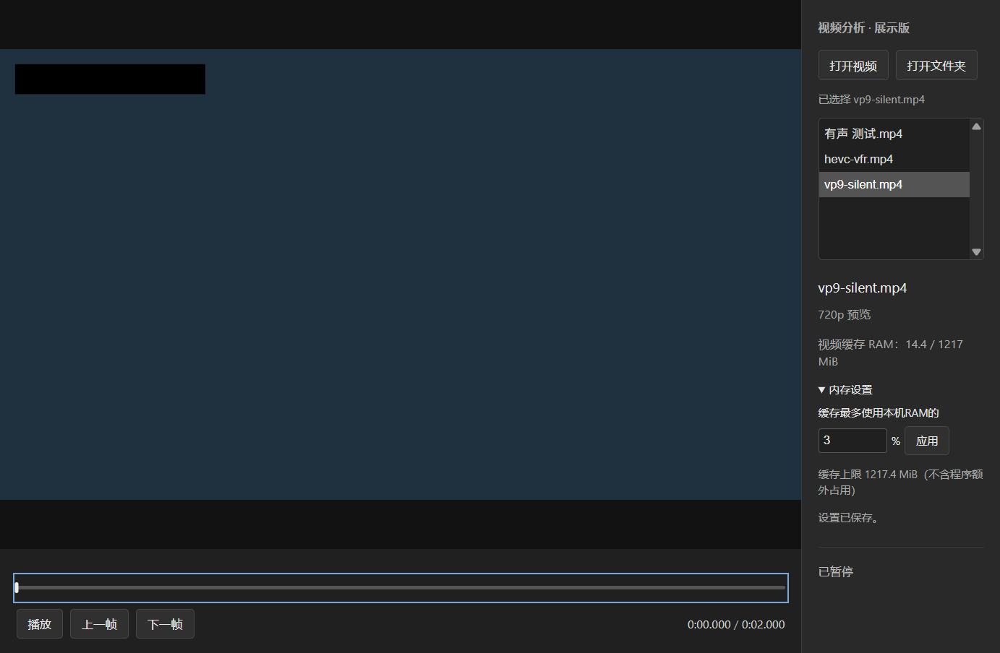

# Eagle Video Analysis · 视频分析

面向 VFX 动效观察的 **Eagle 视频分析插件**。在 Eagle 中选中一段短视频，通过自动准备的720p预览，在独立窗口内播放、快速拖动、逐帧查看，并记录时间点标注。

适合检查特效起落、动作节奏、粒子变化，以及反复对比某个时间点附近的画面。原视频保持不变，无需为了拖动预览而替换原素材。

**当前处于内测开发阶段，尚非稳定版。** 插件是持续开发的主线；无需 Eagle 的绿色版是本次成果的临时展示快照。

[核心功能](#核心功能) · [选择体验方式](#选择体验方式) · [快速开始](#快速开始) · [当前限制](#当前限制) · [开发文档](#开发文档)

## 核心功能

- **自动准备720p预览**：选中视频后自动生成缓存，准备完成即可使用，无需切换“普通／缓存”模式。
- **鼠标拖动观察**：拖动进度条查看画面，上方显示目标时间，便于反复检查局部变化。
- **播放与逐帧**：正常播放、暂停、空格切换播放状态，以及上一帧／下一帧。
- **Eagle时间点标注**：插件读取已有标注，点击定位；暂停后可以添加文字标注。
- **可调缓存内存**：查看当前视频的缓存RAM占用，按本机总内存百分比设置额度。
- **保留原始素材**：生成独立预览缓存，正常关闭时取消并清理未完成的准备任务，完整有效缓存保留以供复用。

两个体验包均没有实验样本、性能测量或证据保存按钮。

## 选择体验方式

| | Eagle插件内测版（推荐） | 独立绿色展示版 |
| --- | --- | --- |
| 定位 | 正式插件的内测快照，后续开发主线 | 无需Eagle的临时体验入口，不单独推进产品开发 |
| 运行条件 | Windows、Eagle 4.0 Build 22+及其FFmpeg模块 | Windows 10 22H2或更新的64位Windows |
| 视频来源 | Eagle当前单选的本地MP4 | 打开或拖入MP4／视频文件夹，右侧列表切换 |
| 预览与控制 | 720p、播放、拖动、逐帧、内存设置 | 同类分析操作，只准备当前选中的视频 |
| 时间点标注 | 读取和添加Eagle素材标注 | 不支持，不访问Eagle素材库 |
| FFmpeg | 使用Eagle中已安装的模块，不随包附带 | 随包内置，无需另外安装 |
| 交付文件 | `eagle-video-analysis-0.1.0-beta.1-20261014.zip` | `video-analysis-standalone-0.1.0-win-x64.zip`（约233MiB） |

**插件内测版已公开预发行**：[发行说明与校验文件](https://github.com/kekedouou/eagle-frame-analyzer/releases/tag/v0.1.0-beta.1) · [直接下载插件ZIP](https://github.com/kekedouou/eagle-frame-analyzer/releases/download/v0.1.0-beta.1/eagle-video-analysis-0.1.0-beta.1-20261014.zip)。

**绿色独立版0.1.0公开发行**：[发行说明与源码材料](https://github.com/kekedouou/eagle-frame-analyzer/releases/tag/standalone-v0.1.0) · [直接下载Windows绿色包](https://github.com/kekedouou/eagle-frame-analyzer/releases/download/standalone-v0.1.0/video-analysis-standalone-0.1.0-win-x64.zip)。

解压后即可使用，无需Eagle或另装FFmpeg。GitHub的“Download ZIP”下载的是源码，不包含绿色版完整运行环境。

详细说明：[插件内测版](docs/beta-preview.md) · [绿色独立版使用说明](docs/releases/standalone-v0.1.0.md)。

## 快速开始

### Eagle插件内测版

1. 确认Eagle中已安装FFmpeg模块；本版无需另外安装Node.js。
2. 将插件内测ZIP解压到 **D、E等非C盘的可写普通目录**。
3. 在Eagle插件开发功能中选择“载入本地插件”，选择**包含 `manifest.json` 的整个解压文件夹**，不要选择单个文件或ZIP。
4. 在Eagle中单选一个不超过30秒的MP4，打开 **“视频分析 · 内测预览”**。
5. 等待预览准备完成，再播放、拖动进度或逐帧查看。换视频时，关闭插件窗口，选中另一素材后重新打开。

需要记录观察时，暂停在目标画面，点击右侧“添加”，输入文字并“保存”。这会写入对应Eagle素材的标注；保存后不会自动删除。当前修改或删除已保存标注需使用Eagle原生界面，原生播放器已打开时不保证立即刷新。

### 独立绿色展示版

1. 将绿色展示ZIP **完整解压到非C盘的可写目录**，不要在ZIP内直接运行，也不要只复制exe。
2. 双击 `VideoAnalysisPreview.exe`，无需安装Eagle、Node.js或FFmpeg。
3. 将MP4或视频文件夹拖进窗口，也可点击右侧“打开视频／打开文件夹”。
4. 等待当前视频自动准备完成。通过右侧列表切换视频；只为当前选中项准备缓存。

上图为绿色展示版的真实运行截图，画面使用合成测试视频；Eagle插件内测版另有素材标注栏。

### 两个版本通用的操作

| 操作 | 方法 |
| --- | --- |
| 播放／暂停 | 点击播放按钮，或按空格；输入框、视频列表等控件聚焦时保留其自身按键行为 |
| 定位画面 | 鼠标拖动底部进度条，查看上方时间提示 |
| 逐帧检查 | 点击“上一帧／下一帧”；进度条聚焦时也可按左右方向键 |
| 调整内存 | 展开右侧“内存设置”，修改百分比并应用；保留当前位置，重新准备后保持暂停，下次沿用设置 |

## 缓存与数据

- **存放位置**：插件内测版在解压目录的 `cache/` 保存预览；绿色版在软件目录的 `data/` 保存缓存和设置。均不使用C盘作为缓存回退位置。
- **容量**：磁盘缓存预算为5GiB，按现有规则淘汰可清理的旧视频缓存。RAM默认额度等效1GiB，按本机物理内存换算百分比，不是启动就占满。
- **内存显示的含义**：额度和侧栏数值针对播放器管理的缓存，不包含浏览器、GPU和FFmpeg的额外占用，不是整个程序的内存硬上限。
- **关闭与复用**：正常关闭等待任务取消和资源释放；未完成缓存清理，完整有效缓存保留。再次打开仍需校验和准备RAM，当前不承诺秒开。
- **手动清理**：先关闭相关窗口并确认进程退出。插件内测版可删除该副本的 `cache/` 清空预览；绿色版可删除其 `data/`，同时恢复默认设置。不要删除原视频或Eagle素材库。

内测插件与开发入口的缓存、设置各自独立，但访问的是同一个Eagle素材库，标注并不隔离。绿色版不与Eagle共享标注或设置。

## 当前限制

- 输入为不超过30秒的普通本地MP4，当前针对H.264、H.265、VP9；绿色展示版另限单文件不超过2GiB。
- 预览固定720p。1080p／2K预览、常驻秒刻度和与Eagle原生播放器播放位置同步尚未提供。
- 第一次准备以及完整缓存复用都可能等待；素材复杂度和电脑性能会影响准备速度与拖动体验。
- 已有部分真实Eagle测试及用户体验反馈，仍未完成全部素材覆盖和长期资源验收；绿色版独立运行结果不代表Eagle宿主验收。
- 插件内测打包副本尚未完成单独的真实Eagle加载验收；当前体验包不代表整个MVP已经通过总验收。

## 反馈问题

请说明使用的是插件内测版还是绿色展示版，并提供：视频时长、已知的分辨率／帧率、内存设置比例、操作步骤、出现问题的时间位置及报错截图。不必为了反馈提供原视频或整个素材库。

## 开发文档

本仓库继续开发Eagle插件；绿色展示副本不回写正式播放器。阶段记录、性能数据及历史实验保留在文档中，主页不再逐条罗列。

[项目说明与运行入口](docs/project-profile.md) · [产品需求](docs/product.md) · [技术架构](docs/architecture.md) · [开发计划](docs/development-plan.md) · [验证协议](docs/verification.md) · [当前进度与实验记录](docs/progress.md) · [Agent规范](AGENTS.md)

## 许可与分发状态

项目自身代码的开源许可证尚未确定，本页不擅自声明MIT或其他许可。绿色包保留Electron/Chromium许可、FFmpeg LGPL-3.0-or-later许可及对应源码、构建参数和来源索引；同一发行页另提供FFmpeg源码附件，运行时无需另行下载。组件版权与核对范围见[第三方说明](demos/standalone-preview/THIRD-PARTY.md)，不将未做的全量依赖复现审计写成通过。体验包通过Release附件单独上传，本地 `dist/` 仍被Git忽略，不将运行包、缓存或用户设置提交到源码仓库。
